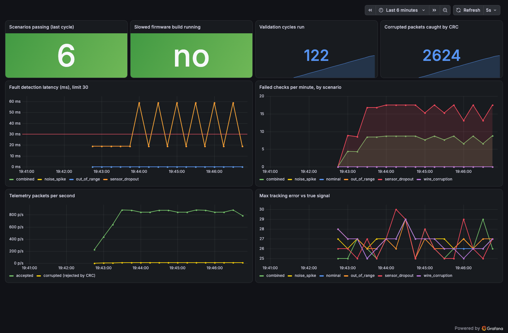

# Firmware Validation Harness

A C++17 project for testing embedded firmware the way a validation team would: run the real firmware against simulated hardware, inject faults, decode its telemetry, check it against pass/fail limits, block regressions against a saved baseline, and monitor everything live in Prometheus and Grafana.



## What's in it

```
firmware/   embedded-style sensor controller (the code under test)
harness/    simulated hardware, fault injection, telemetry decoder, validator, baseline gate
exporter/   tiny HTTP server that exposes results in Prometheus format
monitoring/ Prometheus config + alert rules, Grafana dashboard (provisioned as code)
tests/      unit tests and harness tests (no outside test library)
baseline/   last known-good results; CI fails if a change makes them worse
```

```
 scenario ──> SimHal ──samples──> SensorController (firmware) ──telemetry bytes──> wire
                │                                                                  │
          fault injection                                              bit flips (corruption)
                                                                                   │
              report <── validator <── decoder (sync + CRC-16, resync on bad frames)
                │
      baseline compare (regression gate) ──> exit code for CI
                │
       /metrics ──> Prometheus (alert rules) ──> Grafana
```

### Firmware (`firmware/`)
A sensor controller written like code for a small microcontroller: no heap, no exceptions (`-fno-exceptions`), fixed-size ring buffer, and a hardware abstraction layer (`Hal`) for the ADC, timer and UART so the same code runs on a board or in the harness.

- State machine: `BOOT -> CALIBRATE -> RUN <-> FAULT`
- Calibrates the sensor bias from 64 samples at rest, then filters readings with an 8-sample moving average
- Detects three faults: sensor timeout (no sample for 20 ms), out-of-range reading, and an implausible jump between samples
- Leaves FAULT only after 50 good readings in a row
- Sends 14-byte telemetry frames at 100 Hz, plus an immediate frame on every state change, each with a CRC-16/CCITT checksum

### Harness (`harness/`)
- **Simulated hardware** feeds a noisy 1 Hz signal through a fake clock, one tick per millisecond, fully deterministic from a seed
- **Fault injection:** sensor dropouts, noise spikes, out-of-range readings, and bit flips on the telemetry wire
- **Decoder** parses the raw byte stream, checks every CRC, and resyncs after bad frames
- **Validator** checks, per scenario: reaches RUN in time, every fault detected with the right code within 30 ms, recovery within 150 ms, no false alarms, every corrupted frame rejected and every clean frame intact, 100 Hz telemetry rate, filtered output within 50 counts of the true signal
- **Regression gate** compares each run with `baseline/baseline.csv` and fails if any check that used to pass now fails, or if detection, recovery, false alarms or tracking error get worse

## Results

```
SCENARIO         RESULT DETECT_MS RECOVER_MS  FALSE  TRACK PKTS_OK/SENT  CORRUPT
nominal          PASS           -          -      0     27      301/301        0
sensor_dropout   PASS          19         49      0     26      302/302        0
noise_spike      PASS           0         49      0     27      301/301        0
out_of_range     PASS           0         49      0     27      302/302        0
wire_corruption  PASS           -          -      0     27      283/301       18
combined         PASS          19         49      0     25      299/303        4
```

A firmware change that raises the sensor timeout from 20 ms to 60 ms gets caught:

```
$ ./build/fvh --fw-timeout-ms 60
sensor_dropout   FAIL          59         49      0     26      302/302        0
    FAIL fault_detected_1     sensor_dropout -> SENSOR_TIMEOUT after 59 ms (limit 30 ms)
...
REGRESSIONS vs baseline/baseline.csv:
  sensor_dropout/max_detection_latency_ms            19 -> 59     fault detection got slower
  sensor_dropout/check/fault_detected_1               1 -> 0      passed in baseline, fails now
RESULT: FAIL   (exit code 1)
```

17 unit and harness tests, plus the regression gate, run in CI on every push (release build and an AddressSanitizer + UndefinedBehaviorSanitizer build).

## Build and run

```bash
cmake -S . -B build && cmake --build build -j
ctest --test-dir build --output-on-failure   # unit tests + regression gate
./build/fvh --verbose                        # full report
./build/fvh --fw-timeout-ms 60               # simulate a bad firmware change
./build/fvh --update-baseline                # accept current results as the new baseline
```

## Live monitoring

```bash
brew install prometheus grafana   # or use your package manager
./scripts/run_monitoring.sh
```

- Metrics: http://127.0.0.1:9105/metrics
- Prometheus alerts: http://127.0.0.1:9090/alerts
- Grafana: http://127.0.0.1:3000/d/fvh-overview

In serve mode the harness reruns every scenario every 2 seconds with a new seed, and 4 of every 15 cycles run a slowed firmware build, so the dashboard and alerts have real failures to show. Alert rules cover failing scenarios, fault detection over 30 ms, a high telemetry rejection rate, and a stalled harness.

## Design notes

- **Jump check after a gap.** After a sensor timeout the jump-check reference is cleared. Otherwise the first reading after a dropout is compared with stale data, and a normal change in the signal looks like a spike.
- **Event frames.** State changes are sent right away instead of waiting for the next 10 ms slot, so fault detection latency is measured from the firmware's own report.
- **Determinism.** The harness uses its own xorshift RNG and a simulated clock, so a failing seed always reproduces.
